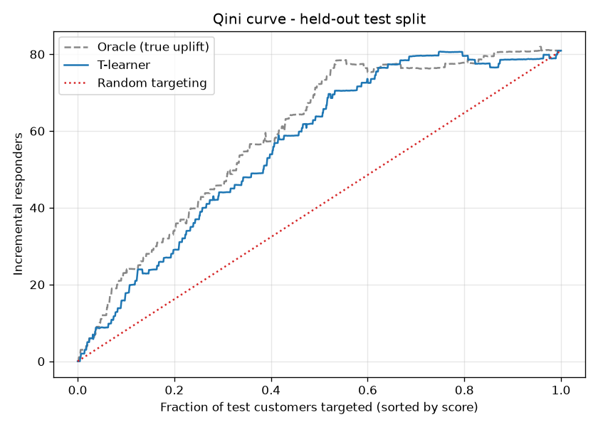
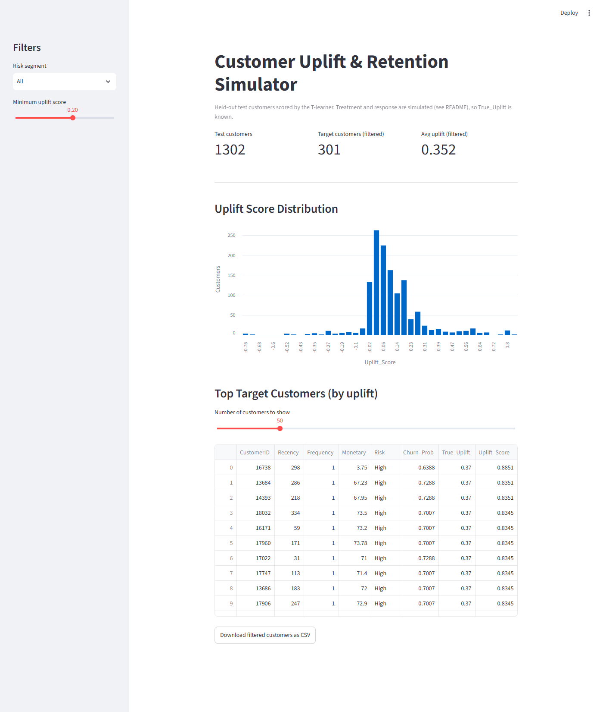

# Customer Uplift & Retention Simulator

Uplift modeling on **real UCI Online Retail transactions** (4,338 customers) with a **simulated, randomized retention campaign** whose true uplift per risk group is known by construction.
A **T-learner** (two Gradient Boosting models) recovers those group effects on a held-out test split.
On the Qini curve it captures **about 85% of the achievable gain over random targeting** (relative to an oracle that ranks by the true uplift).
A Streamlit dashboard lets you filter and export the scored test customers.

Uplift modeling targets the customers whose behavior the campaign actually changes, not simply the ones most likely to churn.

## How it works

The whole pipeline is in [`simulate.py`](simulate.py). [`eda.ipynb`](eda.ipynb) contains only the exploratory analysis.

**1. RFM features.** Cleaned transactions (known customer, positive quantity and price) are aggregated per customer into Recency (days since last purchase), Frequency (number of invoices) and Monetary (total spend).

**2. Churn model.** Churn is defined as no purchase in the last 90 days of the data. An XGBoost classifier predicts it from **Frequency and Monetary** (Recency is left out because it defines the label). On an 80/20 stratified split (868 test customers): **AUC 0.759, accuracy 0.709**. The predicted churn probability is binned into risk groups: Low (≤ 0.3, 1,923 customers), Medium (0.3–0.6, 1,956) and High (> 0.6, 459).

**3. Simulated campaign.** The dataset has no campaign, so one is simulated with `np.random.seed(42)`. Treatment is randomized **50/50 across all customers** (realized treatment rate 50.2%), and response depends only on risk group and treatment:

| Risk group | P(response \| treated) | P(response \| control) | True uplift |
|---|---|---|---|
| High | 0.40 | 0.03 | 0.37 |
| Medium | 0.20 | 0.03 | 0.17 |
| Low | 0.05 | 0.03 | 0.02 |

**4. Uplift model.** Customers are split 70/30 (3,036 train / 1,302 test), stratified by treatment. A T-learner fits one Gradient Boosting classifier on treated and one on control training customers. The uplift score is the difference of their predicted response probabilities. **All reported scores are on the held-out test split**; no customer is scored by a model that saw them.
Features are **Frequency and Monetary** only:
- **Recency** is excluded because it encodes the churn label exactly (churn = Recency > 91).
- **Churn_Prob** is excluded because it is the simulator's own input: risk groups are cut from it, so it would hand the model the answer.

## Results

All numbers below are produced by `python simulate.py` and stored in [`reports/metrics.json`](reports/metrics.json) and [`reports/recovery_table.csv`](reports/recovery_table.csv).



| Targeting (test split) | Area under Qini curve | AUUC |
|---|---|---|
| Random | 40.46 | 80.68 |
| T-learner | 56.06 | 109.74 |
| Oracle (ranked by true uplift) | 58.91 | 114.44 |

The T-learner's gain over random (Qini coefficient) is 15.60, versus 18.45 for the oracle, i.e. **0.85 of the achievable gain**.

**Recovery of the true uplift per risk group (test split):**

| Risk | Test customers | Treated | True uplift | Estimated mean | Observed difference in means |
|---|---|---|---|---|---|
| High | 136 | 65 | 0.370 | 0.371 | 0.371 |
| Medium | 577 | 307 | 0.170 | 0.168 | 0.177 |
| Low | 589 | 281 | 0.020 | 0.036 | 0.009 |

**Business reading.** The campaign generates about 81 incremental responders across the 1,302 test customers. Targeting customers in order of uplift score, the top 20% captures 36% of them, the top 40% captures 67%, and the **top 60% captures 91%** (top 80%: 98%). Most of the campaign's effect can be had for a bit more than half the contact cost.

## Dashboard

`streamlit run app.py` shows the held-out test customers. You can filter by risk segment and minimum uplift score, see the score distribution, compare each customer's true and estimated uplift, and download the filtered list as CSV.



## Limitations

- **Treatment and response are simulated.** Only the transactions are real. The results show that the method recovers a known effect, not that any real campaign works.
- **Best-case recovery.** True uplift depends only on risk groups built from the same two features the uplift model uses, so the model only has to learn a step function of Frequency and Monetary. Real uplift is rarely this cleanly tied to observed features.
- **Per-customer scores are noisy.** Each risk group has one true uplift value, but scores within a group have a standard deviation of 0.10–0.25, and the per-customer RMSE against true uplift is **0.138** (test scores range from −0.76 to 0.89). Use the scores for **ranking**, not as exact per-customer effects.
- **Single seed, no confidence intervals.** All numbers come from one simulation draw and one train/test split, without confidence intervals, so small gaps such as the Low group's estimate (0.036 vs. a true 0.020) cannot be judged.
- The churn label is a fixed 90-day inactivity rule, not observed churn.

## Setup

Requires Python 3.11.

1. Download `Online Retail.xlsx` from the [UCI Machine Learning Repository](https://archive.ics.uci.edu/dataset/352/online+retail) and save it as `data/raw/Online Retail.xlsx`.
2. Create a virtual environment and install dependencies:
   ```bash
   python -m venv .venv
   source .venv/bin/activate        # Windows: .venv\Scripts\activate
   pip install -r requirements.txt
   ```
3. Run the pipeline (writes `data/processed/` and `reports/`):
   ```bash
   python simulate.py
   ```
4. Open the dashboard (reads `data/processed/uplift_scores_test.csv`, which is committed, so this works without step 3):
   ```bash
   streamlit run app.py
   ```
5. Run the tests:
   ```bash
   pytest
   ```

## Project structure

```
simulate.py              pipeline: RFM, churn model, simulation, T-learner, Qini evaluation
app.py                   Streamlit dashboard over the held-out test customers
eda.ipynb                exploratory analysis of the raw transactions
data/processed/          generated customer tables
reports/                 metrics.json, recovery_table.csv, qini_curve.png
docs/                    dashboard screenshot
tests/                   pytest tests
```

## Author

Yigit Uysaloglu · [LinkedIn](https://www.linkedin.com/in/yigit-uysaloglu/) · [GitHub](https://github.com/Yigituysgl)

## License

[MIT](LICENSE)
